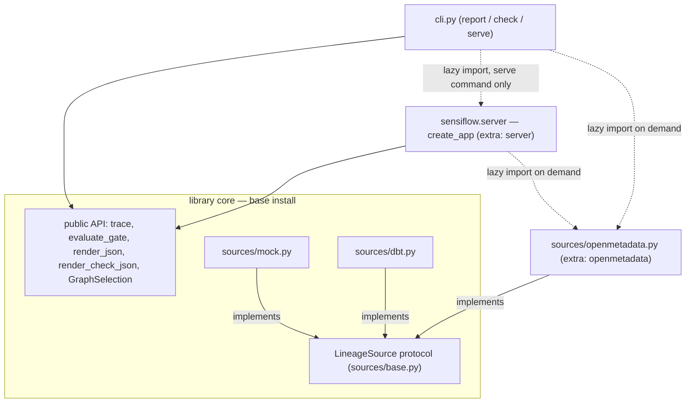

# ADR-0005: HTTP server API and distributable Docker image

- **Status:** Accepted (2026-10-30, after review; all five open questions
  resolved — see Review resolutions)
- **Date:** 2026-10-30
- **Deciders:** Maksim Zolotarev

## Context

sensiflow is a library-first tool: all logic lives in an importable package,
the CLI is a thin wrapper, and CI/CD is the CLI in `check` mode (ADR-0004).
The next deployment shape is a long-running service: run sensiflow as an
endpoint that other systems call over HTTP, instead of installing the CLI
wherever an answer is needed. Concretely:

1. **Shared access without local installs.** A platform team deploys one
   instance next to the catalog; CI pipelines, scripts, and (later) AI agents
   call it. Today every caller must install Python, the package, and hold a
   catalog token.
2. **Token custody.** With the CLI-in-CI pattern every pipeline holds an
   `OMD_TOKEN` secret. A deployed service can hold the catalog credential
   once, server-side, and callers hold none.
3. **A machine contract already exists.** `report --format json` and
   `check --format json` produce stable, additive-only JSON documents, and
   the outcome taxonomy (clean / gate tripped / input error / operational
   error) is fixed by ADR-0004. An HTTP layer should transport these
   contracts, not invent parallel ones.
4. **Constitution constraints.** The core never prints, never exits, and
   knows nothing about how it is invoked (ADR-0001). Connectors live behind
   optional extras and are not imported at package import time (ADR-0002).
   Analysis is read-only; catalog mutation is a separate, explicitly
   confirmed path. A server layer must obey all of this: it is one more
   *consumer* of the library, like the CLI — never something the library
   knows about.
5. **Distribution.** "Deploy it" in practice means a container. The image
   must be buildable from the repo, slim, non-root, and must never bake in
   secrets or non-public working-copy files.

Scope guard: this ADR covers a synchronous request/response HTTP API over
the existing read-only pipeline, and the Docker image that ships it.
Scheduled/recurring scans, result persistence, and multi-catalog serving are
explicitly out of scope (see Alternatives 12–13).

## Decision

### 1. A new optional layer: `sensiflow.server` behind a `[server]` extra

A new subpackage `src/sensiflow/server/` (an application factory
`create_app()` plus request-schema module) that **imports only the public
library API**: `trace`, `evaluate_gate`, `render_json`, `render_check_json`,
`GraphSelection`, the sources, and the exception hierarchy. Nothing under
`sensiflow/` outside `server/` may import `server/`; `sensiflow/__init__.py`
does not import it; the CLI imports it lazily, only when the `serve` command
is invoked — the same guard pattern as the OpenMetadata connector
(ADR-0002 §2). If the extra is missing, `SensiflowDependencyError` names the
fix: `pip install 'sensiflow[server]'`.

```toml
[project.optional-dependencies]
server = ["fastapi>=0.115", "uvicorn>=0.30"]
```

Discipline rule worth stating: if the server layer ever needs something the
public API does not expose, the fix is to promote that thing to public API
deliberately — never to reach into private modules. The server is a peer of
the CLI, not a privileged consumer.

*Diagram: who imports whom, and where the optional-extra boundary runs —
note that no arrow points **into** the server layer except the CLI's lazy
one.*



### 2. Framework: FastAPI served by uvicorn

FastAPI (which brings starlette and pydantic) is the chosen framework, run
under plain `uvicorn` (not `uvicorn[standard]` — uvloop/httptools buy
nothing at this tool's load profile).

Justification against the zero-new-dependencies preference: an HTTP server
is precisely the case where hand-rolling is false economy. What FastAPI buys
for the weight: declarative request validation (every malformed body is
rejected with a structured 422 before our code runs), first-class type
annotations that survive `mypy --strict`, and an auto-generated OpenAPI
document (`/openapi.json`, `/docs`) — which directly serves the planned
AI-agent interface work: agents consume OpenAPI schemas natively. All of it
is confined to the `[server]` extra; the base install keeps its single
dependency (`sqlglot`).

**Boundary rule for models — pydantic in, renderer dicts out.** Pydantic
models exist only for *request* bodies (validation is their job). Responses
are **not** re-modeled in pydantic: the response bodies are the existing
`render_json` / `render_check_json` documents, returned verbatim. Those
dicts are already the published machine contract with an additive-only
evolution rule (ADR-0004 §4); duplicating them as pydantic response models
would create a second source of truth that drifts. The core keeps its
dataclasses untouched — pydantic never crosses the library boundary.

### 3. Endpoint set (v1) — read-only, versioned under `/v1`

| Method & path | Purpose | Success response |
|---------------|---------|------------------|
| `GET /v1/health` | Liveness probe | `200` `{"status": "ok", "version": "<__version__>"}` |
| `POST /v1/report` | Full trace report | `200`, body = `render_json(result)` document |
| `POST /v1/check` | Policy gate | `200`, body = `render_check_json(result, outcome)` document (`tripped` is in the body) |

**There are no mutation endpoints, and that is a decision, not an
omission.** The write-back feature (`propagate`, designed separately) is not
exposed over HTTP in this version: catalog mutation requires explicit,
per-invocation human confirmation by design (ADR-0001 §5), and an HTTP
endpoint is exactly the place where that confirmation degrades into a
boolean in a request body that some script sets to `true` forever.
Consequence: the server can — and should — be deployed with a **read-only
catalog token**; the deployment docs state this. Exposing mutation later, if
ever, requires its own ADR with an authentication and audit story.

**Request schema** — one shape shared by `report` and `check` (the gate adds
its policy fields), mirroring `GraphSelection` field-for-field. The
shape-stable spec object from the ADR-0002 amendment pays off here: the HTTP
schema is a transcription of it, and future scoping fields extend both in
lockstep.

```jsonc
POST /v1/check
{
  "source": "openmetadata",        // "openmetadata" | "mock"
  "selection": {                    // optional; omitted = full scan
    "roots": ["demo.wh.sales.orders"],
    "patterns": ["demo.wh.crm.*"],
    "from_seeds": false,
    "upstream_depth": null,
    "downstream_depth": null
  },
  "dialect": "bigquery",           // optional, default as in the library
  "fail_on": "HIGH",               // check only; required there
  "min_confidence": 0.0            // check only; optional
}
```

The pydantic model checks shape and types; **semantic** validation stays
where it lives today — `GraphSelection.__post_init__` and `evaluate_gate` —
so library, CLI, and HTTP callers get byte-identical rules from one
implementation. Selectors are inline only: there is no roots-file upload and
no server-side file path accepted from callers (a caller-supplied path is a
path-traversal primitive; the YAML file is a *local CLI* convenience — its
contents arrive here as plain `roots`/`patterns`).

Why `POST` for read-only operations: the request is a structured document
(lists of roots and patterns, depths, policy), which does not belong in a
query string; URLs are also logged by every proxy on the path, and the
request shape must stay safe to log. The operations remain strictly
read-only regardless of the verb.

`source: "mock"` is served like everywhere else, giving a catalog-free smoke
test of a live deployment: `POST /v1/check {"source": "mock", "fail_on":
"HIGH"}` must trip. The dbt source is **not** reachable over HTTP in v1 —
see Decision 5 and Alternatives 8–9.

### 4. Outcome-to-HTTP mapping — the taxonomy transported, not redefined

ADR-0004's outcome classes map onto HTTP as follows; this table is contract,
versioned with the API:

| Outcome (ADR-0004) | CLI exit | HTTP status | Body |
|--------------------|----------|-------------|------|
| Run completed, below threshold | 0 | `200` | check/report document, `"tripped": false` |
| Gate tripped | 1 | `200` | check document, `"tripped": true` |
| Usage / input error (`SensiflowInputError`, incl. cyclic graph, zero-match pattern) | 2 | `400` | structured error body |
| Malformed request body (framework validation) | 2 | `422` | FastAPI's native validation document |
| Catalog unreachable / catalog auth failure (`SensiflowConnectionError`) | 3 | `502` | structured error body |
| Server deployment lacks a required extra (`SensiflowDependencyError`) | 3 | `500` | structured error body |
| Unexpected internal error | 3 | `500` | structured error body (generic; traceback goes to the server log only, never to the client) |

The pivotal row: **a tripped gate is `200`, not an error status.** HTTP
status codes describe whether the *request* was served, not the domain
verdict; the check ran to completion and produced its answer. A CI caller
reads `tripped` from the body (`curl ... | jq -e '.tripped | not'` is the
one-liner). Encoding the verdict as 4xx/5xx would conflate "your pipeline
has a PII exposure" with "the service is broken", poison error-rate
monitoring and retry middleware, and break the moment a caller uses
`--fail-with-body`-style tooling (see Alternative 6).

Structured error body, additive-only like every other machine document:

```json
{"error": {"kind": "input", "message": "root pattern 'demo.wh.crm.*' matched no tables"}}
```

`kind` is one of `input` / `connection` / `dependency` / `internal`.
Messages reuse the library's exception messages, which are already
secret-free by construction (ADR-0002 §5); tracebacks and upstream response
bodies never appear in a client-facing error.

*Diagram: one `POST /v1/check` request end to end — where credentials enter
(server env, never the request) and where the outcome taxonomy becomes an
HTTP status.*

```mermaid
sequenceDiagram
    participant C as Caller (CI job)
    participant S as sensiflow.server (FastAPI)
    participant L as library (trace / evaluate_gate / render_check_json)
    participant O as OpenMetadataSource
    participant M as OpenMetadata catalog

    C->>S: POST /v1/check (source, selection, fail_on) — no credentials
    S->>S: validate body (pydantic); malformed -> 422
    S->>O: build_graph(GraphSelection) using OMD_HOST / OMD_TOKEN from server env
    O->>M: GET /api/v1/... (Bearer token)
    M-->>O: tables + lineage
    O-->>S: LineageGraph
    S->>L: trace(graph), evaluate_gate(result, fail_on), render
    L-->>S: check document with tripped flag
    S-->>C: 200 + render_check_json body (tripped true or false)
    Note over C,S: errors: SensiflowInputError -> 400, SensiflowConnectionError -> 502, SensiflowDependencyError or unexpected -> 500 (traceback to server log only)
```

### 5. Catalog credentials are server-side configuration — never per-request

The deployment binds exactly one catalog at startup via the existing
environment variables (`OMD_HOST`, `OMD_TOKEN`). Request bodies carry **no**
host and **no** token. The connector's host validation (http/https scheme
required, no userinfo) applies unchanged at first use.

This is the central security decision of the API, chosen over per-request
credentials for three reasons:

1. **SSRF.** A caller-supplied `omd_host` makes the server an open proxy
   into whatever network it is deployed in — "fetch this internal URL with
   a bearer header of my choosing, as the server". Allow-listing hosts
   safely is its own project; not accepting them is free.
2. **Token custody and transit.** Per-request tokens mean every caller
   holds the secret and it crosses the wire on every call — the opposite of
   the custody improvement that motivates a server (Context 2).
3. **Log hygiene.** With no secrets in request bodies, bodies are safe to
   log at debug level and safe to echo in validation errors. One class of
   leak is removed structurally instead of by vigilance.

Consequences accepted: one server instance serves one catalog
(multi-catalog = multiple deployments — fine for the tool's scale), and the
CI caller story becomes *better* than the CLI's: a pipeline calls
`POST /v1/check` with scoping and policy only, and holds **zero** secrets.

The **dbt source is deferred to v2** as a consequence of the same stance:
its input is a local file, and every way of providing one over HTTP is
either a path-disclosure risk (caller-supplied server paths) or a new
upload/size-limit/parsing-untrusted-input surface (multipart upload of
multi-megabyte manifests). dbt's natural home is the CLI inside the dbt
repo's own CI, which already works. If demand materializes, the two v2
candidates are: a server-configured manifest directory (deployment mounts a
volume; callers name a file within it, no traversal) or a size-capped
upload. Decided then, not now (Alternatives 8–9).

### 6. Sync endpoints; the connector stays sync

Endpoints are plain `def` functions. FastAPI/starlette run sync endpoints in
a worker threadpool, so the event loop is never blocked. The OpenMetadata
connector keeps its synchronous `httpx` client unchanged.

Rationale: a trace is dominated by CPU-bound work (sqlglot parsing,
propagation), where async buys nothing; the catalog I/O part is a BFS of
dependent requests, not a fan-out that async would accelerate. Rewriting a
working, tested connector to `httpx.AsyncClient` would be risk and churn for
no measured benefit — and mixing a sync client into async endpoints is the
one configuration that actually *would* block the loop. Sync `def` is the
boring, correct choice. The server runs as a single uvicorn process in v1;
scaling is horizontal (more containers), which also sidesteps GIL questions.

### 7. Observability and logging — the server layer's job

The library never prints and never logs user-facing output; the server layer
owns all of it, via stdlib `logging` (no logging dependency):

- uvicorn's access log stays on;
- one application log line per analysis request: source, selector counts,
  nodes analyzed, duration, verdict (`tripped`/clean) or error kind. Never a
  token (the connector's exceptions exclude it by construction) and never a
  raw upstream response;
- unexpected exceptions: full traceback to the server log, generic
  `{"error": {"kind": "internal", ...}}` to the client;
- `GET /v1/health` is pure liveness: it returns `ok` and the package version
  without touching the catalog. A catalog outage must not make an
  orchestrator kill and restart the container (restarting cannot fix the
  catalog), and a liveness probe must not generate catalog traffic. A
  readiness variant that pings the catalog is a compatible later addition.

No metrics/tracing exporters in v1 — each is a dependency and a config
surface; the access log plus the per-request line cover the "is it working,
what is it doing" minimum. Revisit on operational evidence.

**API authentication (decided at review):** the server ships an opt-in
static bearer token — if `SENSIFLOW_API_TOKEN` is set in the environment,
every `/v1/report` and `/v1/check` request must carry
`Authorization: Bearer <token>` (constant-time comparison); `/v1/health`
stays open for probes. If unset, the API is open and the server logs a
prominent startup warning. Rationale: the server fronts a catalog
credential, so a zero-cost shared-secret guard is worth having from day one,
while mandatory auth would complicate the local/demo path (see Review
resolution 1 and Alternatives: "no auth at all" and "mandatory token" were
both considered and rejected in review).

### 8. CLI: `sensiflow serve`

```
sensiflow serve [--host 127.0.0.1] [--port 8000]
```

A new subcommand that lazily imports the server extra and runs uvicorn
programmatically on `create_app()`. The default bind is `127.0.0.1`
(safe-by-default; containers and real deployments pass `--host 0.0.0.0`
explicitly). The command lives inside the CLI-wide error wrapper
(ADR-0004 A1): a missing `[server]` extra is a `SensiflowDependencyError` —
exit 3 with the install hint. `serve` performs no TLS: transport security
terminates at the deployment's reverse proxy or ingress, which is the
operational norm and keeps certificate handling out of the tool.

Deployments that prefer their own ASGI stack can bypass the CLI and point
any ASGI server at the `create_app()` factory directly — the factory, like
everything else, is importable library surface (within the extra).

### 9. Docker image

A `Dockerfile` at the repo root, with these pinned properties:

- **Multi-stage build.** Stage 1 (builder, full python image): install
  poetry, `poetry build` the wheel, export the pinned main-dependency set.
  Stage 2 (runtime, `python:3.13-slim`): `pip install` the exported
  requirements and the wheel with the `server`, `openmetadata`, and `yaml`
  extras. No poetry, no compilers, no source tree in the runtime image.
- **One image, CLI and server both.** `ENTRYPOINT ["sensiflow"]`,
  `CMD ["serve", "--host", "0.0.0.0", "--port", "8000"]`. Default `docker
  run` starts the server; `docker run <image> check --source ... --fail-on
  HIGH` uses the same image as a containerized CLI (which is why the `yaml`
  extra is included — roots files are a CLI feature). `EXPOSE 8000`.
- **Non-root.** A dedicated user (fixed UID, e.g. 10001) created in the
  runtime stage; `USER` set before `ENTRYPOINT`. No writable paths are
  needed — the service holds no state.
- **No secrets in layers, structurally.** No `ENV` with credential defaults,
  no `.env` handling, no `COPY` of anything beyond
  `pyproject.toml`/`poetry.lock`/`src`/`README.md`/`LICENSE` into the
  builder. Tokens arrive only at runtime (`docker run -e OMD_TOKEN=...` or
  the orchestrator's secret mechanism).
- **Allow-list `.dockerignore`.** The file ignores everything (`*`) and then
  re-includes only the build inputs. This is a hard requirement, not style:
  `docker build .` ships the *working tree*, not git — files that are
  gitignored but present in working copies (local notes, `.env`, editor and
  agent config directories) would otherwise enter the build context and can
  end up in layers. A deny-list would have to enumerate every such file and
  would silently miss the next one; the allow-list fails closed.
- **`HEALTHCHECK`** hitting `/v1/health` via a `python -c` urllib one-liner
  (slim images ship no curl/wget).
- **Tagging tied to the package version**: the image for a given build is
  tagged with the exact `__version__` (`sensiflow:<semver>`); mutable
  convenience tags (`latest`) point at the newest release. Image publication
  to GHCR is a follow-up once repository CI exists, not part of this slice
  (Review resolution 4).
- **No compose file in v1.** A single stateless container needs only a
  `docker run` line, which the README documents. The genuinely useful
  compose — sensiflow next to a seeded OpenMetadata sandbox as a
  self-contained demo — is a real asset but a separate piece of work
  (synthetic seed data included); deferred (Alternative 11).

### 10. API versioning and testing strategy

- Paths live under `/v1`. Within `/v1` the evolution rule is the same as the
  JSON documents': **additive-only** — new endpoints, new optional request
  fields, new response keys; never a change to the meaning or type of an
  existing one. A breaking change means `/v2` and, post-1.0, a major
  version.
- Tests (written with the feature, per project rules): endpoint tests over
  the in-process ASGI test client against the mock source — no network, no
  running server; the full status-mapping table exercised per row (including
  "tripped is 200"); auth guard on/off; error-body shape and
  secret-absence assertions. The Docker build gets a CI smoke step
  (build, run, probe `/v1/health`, one mock `check`) once repo CI exists.

## Consequences

### Positive

- One deployed instance serves many callers; CI pipelines calling
  `POST /v1/check` hold zero secrets — strictly better token custody than
  CLI-in-CI.
- The HTTP contract is a transport over existing published contracts
  (renderer documents + outcome taxonomy); no second source of truth, no
  drift surface.
- The base install is untouched: all server weight sits behind `[server]`;
  the library/CLI user never pays for it.
- The free OpenAPI document is a down payment on the planned AI-agent
  interface: agents can consume the API schema-first.
- Read-only by construction plus the read-only-token deployment
  recommendation: a compromised or buggy server cannot mutate the catalog.
- The image doubles as a zero-install CLI distribution channel.

### Negative / accepted trade-offs

- **Dependency step-change** for the extra: fastapi + starlette + pydantic
  (+ core) + uvicorn is the largest dependency grant in the project so far.
  Confined to `[server]`, but it is real supply-chain surface and belongs in
  the routine dependency audits.
- **One instance, one catalog, no per-request override** — flexibility
  deliberately traded for the SSRF/custody/log-hygiene wins of Decision 5.
- **dbt is CLI-only for now**; dbt shops get no server value until v2
  resolves the file-transport question.
- **Opt-in (not mandatory) API auth** means a misconfigured deployment can
  expose catalog-derived PII *metadata* (column names, owners, lineage — not
  data values) to its network. Mitigated by the loud startup warning and
  deployment docs; accepted at review (Review resolution 1).
- **Single-process sync serving** caps throughput at roughly one CPU-bound
  trace at a time per container. Accepted for v1's load profile
  (CI calls, interactive queries); the scaling story is horizontal.
- **Two run-mode surfaces** (CLI and HTTP) must now be kept consistent when
  the library grows a feature. The thin-transcription design (request schema
  mirrors `GraphSelection`; responses are renderer output) keeps that cost
  low but not zero.

### Follow-ups

- Image publication pipeline (registry, provenance/signing, version-tag
  automation) once repo CI exists.
- Readiness probe variant (catalog connectivity) if deployments ask for it.
- The OMD-sandbox compose demo as its own small slice.
- Revisit metrics (Prometheus) and a `--workers` knob on operational
  evidence only.

## Alternatives considered

### Framework

1. **stdlib `http.server` / hand-rolled WSGI.** Zero dependencies — the
   project's default preference — but `http.server` is documented as not
   production-grade; routing, request validation, JSON error handling,
   concurrency, and graceful shutdown all become hand-maintained code. For
   an HTTP boundary, the hand-rolled validation layer is where bugs with
   security weight live. Rejected: this is the case the "any new dependency
   needs justification" rule exists to *allow*.
2. **Flask.** Mature and boring, but WSGI-only (needs gunicorn anyway),
   validation and OpenAPI require third-party additions (back to a
   dependency pile, just a less-typed one), and its decorator-global style
   fits mypy-strict poorly. Rejected.
3. **Starlette alone (no FastAPI).** Lighter — drops pydantic — but we would
   hand-write request validation and get no OpenAPI document; FastAPI *is*
   the validation + schema layer over starlette, and those two features are
   exactly what we came for. Rejected.
4. **Litestar.** Feature-comparable and notably supports plain dataclasses
   for validation (tempting given our model layer) — but it brings its own
   serialization stack (msgspec), a much smaller ecosystem/bus-factor than
   FastAPI's, and the dataclass synergy is moot because our responses bypass
   framework modeling entirely (Decision 2). Rejected; honorable mention.

### Boundary modeling

5. **Pydantic response models mirroring the renderer documents.** Gains
   response-side OpenAPI schemas; costs a duplicated contract that must be
   maintained in lockstep with `render_json`/`render_check_json` forever,
   with drift failing silently. Rejected — the renderer dict *is* the
   contract; a response schema can be documented by example. Revisitable if
   OpenAPI response typing proves valuable for agent consumers.

### Verdict transport

6. **Non-2xx status for a tripped gate** (e.g. `409` or `422` when
   `tripped`). Lets naive `curl --fail` scripts gate without reading the
   body, but conflates domain verdicts with service health: error-rate
   dashboards and retry middleware treat every tripped gate as a failing
   service, and the same request flips status by data content. Rejected;
   `jq -e '.tripped | not'` is the supported one-liner.
7. **GET with query parameters for report/check.** RESTfully pure for
   read-only semantics, but selector lists and policy do not fit query
   strings, and URLs leak into every access log on the path. Rejected.

### dbt over HTTP (v1)

8. **Manifest upload endpoint.** Multi-megabyte uploads, body-size limits,
   parsing untrusted files server-side, and a caching/retention question —
   a real feature with a real attack surface, not a transport detail.
   Deferred to v2 rather than rejected.
9. **Caller-supplied manifest path on a server volume.** Minimal code, but a
   caller-controlled filesystem path is a read-what-you-like primitive
   unless confined to an allow-listed directory — which is the v2 candidate
   shape, requiring deployment conventions this slice should not rush.
   Deferred.

### Credentials

10. **Per-request catalog host/token (or hybrid with server default).**
    Maximum flexibility, decisively rejected for v1: caller-controlled
    upstream URLs are an SSRF primitive, tokens would transit on every call
    and sit in every caller's config, and request bodies would stop being
    safe to log (Decision 5). Hybrid variants inherit all of it. A future
    multi-tenant need would have to solve authentication first anyway.

### Packaging and distribution

11. **docker-compose for the local demo.** For one stateless container it
    adds a file that duplicates a `docker run` line. The valuable compose
    (bundled OMD sandbox with synthetic seed data) is its own slice.
    Rejected for v1.
12. **A separate package/repo (`sensiflow-server`).** Cleanest dependency
    isolation, but an extra achieves the same isolation at zero release and
    versioning overhead, and the server tracks the library contract tightly
    enough that separate versioning would hurt. Rejected at this scale.
13. **Scheduler built into the server** (cron-style recurring scans). Out of
    scope: every deployment platform already has a scheduler (CI cron,
    Kubernetes CronJob, systemd timers) that can call `POST /v1/check` or
    run the CLI image; building one in adds state and config for a solved
    problem. Rejected.
14. **MCP server instead of (or before) HTTP.** The planned agent interface
    could be served as MCP directly — but MCP targets one consumer class,
    while a plain HTTP API serves CI, scripts, humans-with-curl, *and*
    agents; an MCP layer can later wrap the same library (or this API)
    without conflict. HTTP first. Deferred, not rejected.

## Review resolutions (2026-10-30)

The five questions the draft left open were resolved at review:

1. **API authentication in v1: opt-in static bearer token** via
   `SENSIFLOW_API_TOKEN`, as drafted in Decision 7, with the prominent
   startup warning when unset. The alternatives — no auth at all (network
   perimeter only) and a mandatory token — were both rejected: the former
   leaves a credential-fronting service with zero built-in guard, the
   latter hurts the local/demo path for little gain over opt-in.
2. **Credentials stance confirmed** (Decision 5): server-side environment
   configuration only; per-request host/token stays rejected; the
   one-instance-one-catalog consequence is accepted.
3. **dbt over HTTP: deferral to v2 confirmed.** v1 serves `openmetadata`
   and `mock` only; the v2 direction (allow-listed manifest directory vs
   size-capped upload) is decided when the work is scheduled.
4. **Image publication: follow-up confirmed** — GHCR, automated once
   repository CI exists; not part of this slice.
5. **No compose file in v1 confirmed**; the OpenMetadata-sandbox demo
   compose (with synthetic seed data) goes to the backlog as its own item.
