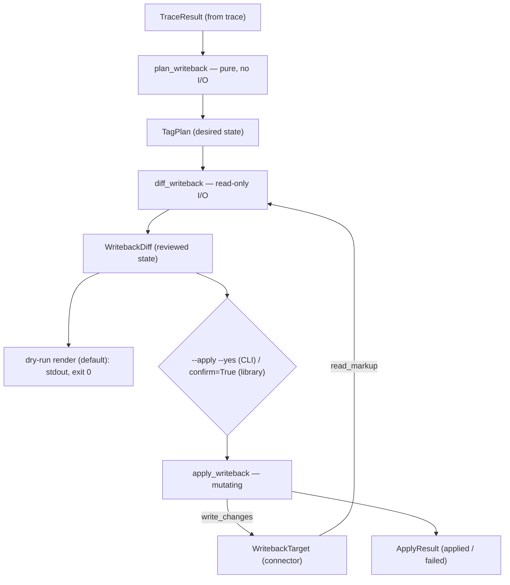
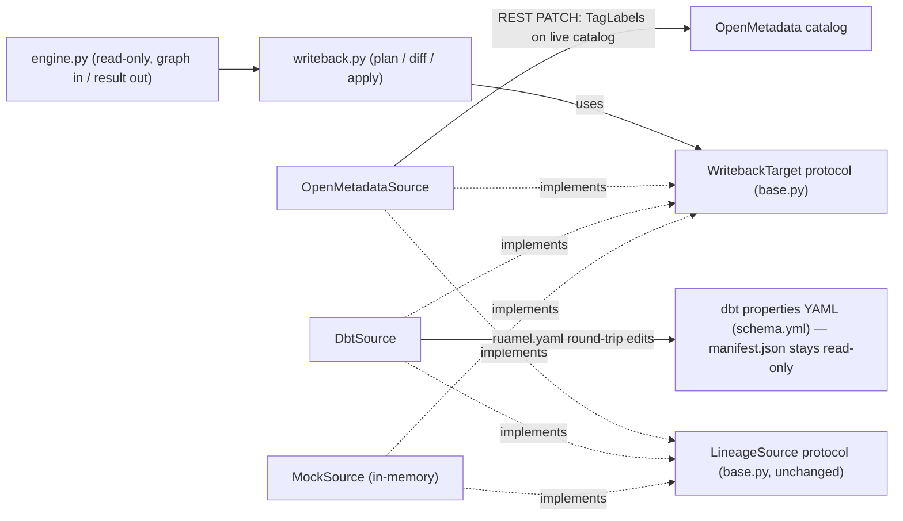
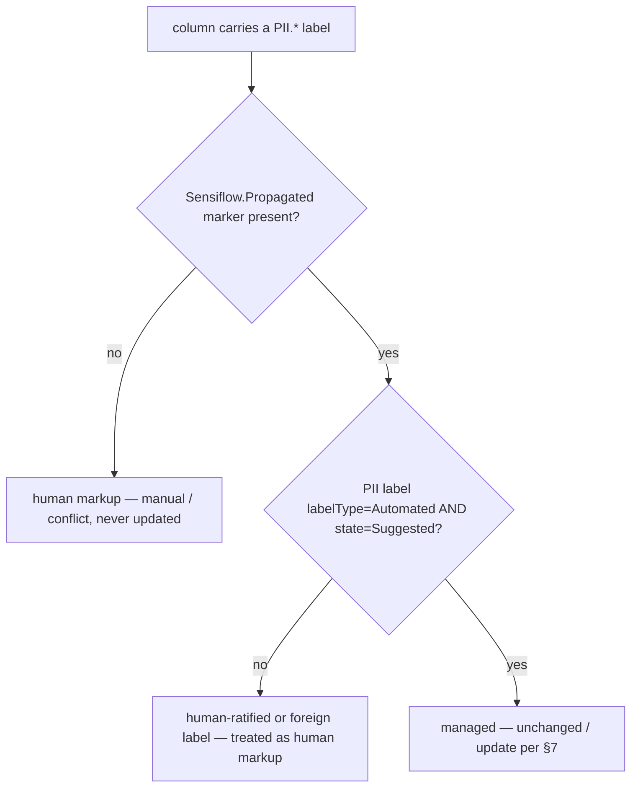

# ADR-0006: `propagate` — explicit write-back of derived PII markup

- **Status:** Accepted (2026-10-30, after review; all seven open questions
  resolved as recommended — see Review resolutions). Amended 2026-10-30
  (A1–A7, post-implementation review).
- **Date:** 2026-10-30
- **Deciders:** Maksim Zolotarev

## Context

The read-only pipeline is complete: three sources behind `LineageSource`
(mock, OpenMetadata, dbt), the propagation engine (ADR-0001), `report`, and
the `check` CI gate with its frozen exit-code taxonomy (ADR-0004). The one
capability promised since ADR-0001 §5 and still missing is **write-back**:
materializing the engine's derived findings as actual PII markup on the
descendant nodes, so that humans and other tools browsing the catalog see
the exposure without running sensiflow.

Forces:

1. **Mutation must be explicit, separate, and reviewable.** The accepted
   constitution (ADR-0001 §5, the packaging model) already fixes the shape:
   read and mutate are strictly separated; `plan_writeback` is pure and *is*
   the dry-run (the default); `apply_writeback` refuses to run without
   `confirm=True`; the CLI's `--apply` requires `--yes`. Propagated markup
   must never appear as a side effect of `report` or `check` — write-back is
   its own command, enabled only by explicit flags.
2. **The two write targets differ in kind.** OpenMetadata is a live catalog
   with a tag API: write-back is a REST mutation of catalog entities. A dbt
   `manifest.json` is a **build artifact** — writing into it is meaningless,
   because `dbt compile` regenerates it from source. The real source of
   truth in a dbt project is its properties YAML (`schema.yml` files). A
   design that supports both from day one must not flatten the OpenMetadata
   path to the lowest common denominator (e.g. "everyone just gets a patch
   file") nor pretend the dbt path is a REST call.
3. **Derived markup must be distinguishable from human markup.** Findings
   are heuristic (ADR-0001 §4: name matching, aliasing, `SELECT *` all
   lower confidence). Tags the tool writes must be visibly tool-written, so
   that (a) humans can audit and revert them, (b) re-runs are idempotent
   rather than duplicative, and (c) the tool's own readers do not mistake
   yesterday's propagated tags for fresh human-declared seeds.
4. **The seeding feedback loop is a real hazard.** Both connectors read
   PII markup as seeds (`declared_pii`). If `propagate` writes markup that
   the next `build_graph` reads back as a seed, every tagged descendant
   becomes an `ORIGIN` on the next run: risks inflate, origins are lost,
   and repeated runs amplify. Write-back is only safe if the written tags
   are excluded from seeding.
5. **Human markup outranks derived markup.** A hand-placed tag — including
   one that contradicts the tool's derivation — must never be overwritten
   or stacked over. Conflicts are surfaced, not resolved.
6. **The exit-code taxonomy is frozen.** ADR-0004 fixed codes 0/2/3 for all
   commands and reserved the question of whether `propagate` may use 1 to
   this ADR.

## Decision

### 1. A separate `propagate` command; three-stage pipeline: plan → diff → apply

Write-back never happens implicitly. `report` and `check` remain strictly
read-only; derived markup is materialized only by the new `propagate`
command (CLI) or by explicitly calling the write-back API (library). The
pipeline has three stages with strictly increasing authority:

| Stage | Function | I/O | Purpose |
|-------|----------|-----|---------|
| plan | `plan_writeback(result, ...)` | pure, no I/O | desired derived markup, computed from `TraceResult` only |
| diff | `diff_writeback(plan, target)` | **read-only** I/O | reconcile the plan against the target's *current* markup |
| apply | `apply_writeback(diff, target, confirm=...)` | mutating I/O | execute the diff's pending changes |

The CLI's default mode (dry-run) executes plan + diff and renders the
result; `--apply --yes` executes all three. The diff — not the raw plan —
is what the user reviews and what gets applied: it already accounts for
tags that exist, conflicts, and columns the target cannot locate, so the
dry-run output is exactly what `--apply` would do.

*Where the mutation boundary sits: everything above the confirmation gate
is pure or read-only; only the last step writes.*



### 2. Library API (`writeback.py`)

```python
WritebackAction = Literal[
    "add",        # column has no markup; tag will be written
    "update",     # sensiflow-managed markup exists but payload differs (risk/confidence/
                  # sensitivity changed); will be rewritten
    "unchanged",  # sensiflow-managed markup already matches; no-op
    "manual",     # compatible human-placed markup exists; left alone, nothing written
    "conflict",   # human-placed markup contradicts the derivation; left alone, flagged
    "unmatched",  # the target has no such column (e.g. a JOIN-only HIGH finding whose
                  # column is not in the node's physical schema); nothing to write
    "stale",      # sensiflow-managed markup exists but no current finding supports it;
                  # reported only — removal is out of scope in v1 (§7)
]

@dataclass(frozen=True)
class TagChange:
    node_id: str
    node_name: str
    column: str
    tag: PiiTag
    risk: Risk
    confidence: float
    origin_node: str
    action: WritebackAction = "add"
    detail: str = ""            # human-readable qualifier (e.g. the conflicting tag)

@dataclass
class TagPlan:                   # output of plan_writeback — desired state, target-agnostic
    min_risk: Risk
    min_confidence: float
    changes: list[TagChange]                       # all action="add" at this stage
    suppressed: list[TagChange]                    # at/above min_risk but below min_confidence

@dataclass
class WritebackDiff:             # output of diff_writeback — reconciled against the target
    plan: TagPlan
    changes: list[TagChange]     # every entry re-classified with its final action
    @property
    def pending(self) -> list[TagChange]: ...      # actions {"add", "update"} only

@dataclass
class ApplyResult:
    applied: list[TagChange]
    failed: list[tuple[TagChange, str]]            # change + error message

def plan_writeback(
    result: TraceResult, *, min_risk: Risk, min_confidence: float = 0.0
) -> TagPlan: ...

def diff_writeback(plan: TagPlan, target: WritebackTarget) -> WritebackDiff: ...

def apply_writeback(
    diff: WritebackDiff, target: WritebackTarget, *, confirm: bool
) -> ApplyResult: ...
```

- `plan_writeback` selects findings with `risk >= min_risk` (rank order per
  `RISK_RANK`; valid thresholds `LOW`/`MEDIUM`/`HIGH` — `ORIGIN` and `NONE`
  are rejected with `SensiflowInputError`, same rule as the gate) and
  `confidence >= min_confidence`. The confidence comparison reuses the
  ADR-0004 A4 rule verbatim: inclusive, at published 4-decimal precision.
  `ORIGIN` findings rank below `LOW`, so seeds are never written back onto
  themselves. Below-confidence findings go to `suppressed` — surfaced, never
  silently dropped (same principle as ADR-0004 §5).
- `apply_writeback` raises `SensiflowInputError` unless `confirm is True` —
  the single library-level enforcement point. It applies only
  `diff.pending`; per-change failures are collected into
  `ApplyResult.failed` and do not abort the remaining changes (each change
  is independent, and a re-run converges: already-applied changes diff to
  `unchanged`).
- All three functions and the dataclasses are public API, exported from the
  package root. Core code never prints and never exits.

### 3. A separate `WritebackTarget` protocol — `LineageSource` does not grow write methods

`sources/base.py` gains a second, independent protocol:

```python
class WritebackTarget(Protocol):
    def read_markup(self, node_ids: Sequence[str]) -> dict[tuple[str, str], ExistingTag]:
        """Current column markup on the given nodes, read-only.
        Key: (node_id, column). Covers both human-placed PII markup and
        sensiflow-managed markup (managed=True)."""
    def write_changes(self, changes: Sequence[TagChange]) -> ApplyResult:
        """Execute the changes. Mutating. Called only via apply_writeback."""
```

with `ExistingTag` a small frozen dataclass `(tag: PiiTag, managed: bool)`.

- `LineageSource` stays read-only and unchanged — read-only sources (and
  any future contract/ODCS source) are never forced to stub out write
  methods. The OpenMetadata and dbt connectors implement **both**
  protocols; a connector that implements only `LineageSource` simply cannot
  be used with `propagate` (the CLI reports a usage error, exit 2).
- Diff classification (the `WritebackAction` rules in §7) lives **once** in
  `writeback.py`, operating on the neutral `ExistingTag` shape; connectors
  only translate their catalog's reality into it and execute writes. No
  connector reimplements conflict policy.
- **Mock story:** `MockSource` implements `WritebackTarget` in memory
  (applied changes mutate its in-memory state and are visible to a
  subsequent `read_markup`). This gives offline tests and
  `sensiflow propagate --source mock` a full plan → diff → apply → re-diff
  cycle with no network — the same role the mock plays for `report` and
  `check`.
- The engine is untouched: `writeback.py` consumes a `TraceResult` and a
  `WritebackTarget`; it never sees a catalog client, and the engine never
  sees write-back.

*Which protocol the write capability lives in, and how the two targets
differ in kind — live catalog mutation vs editing project source files:*



### 4. What gets written: native markup plus a sensiflow marker; marked columns never seed

The written markup has two parts on every target: the **native PII
convention** of that ecosystem (so humans and third-party tools see
standard markup, not a proprietary dialect) and a **sensiflow marker** (so
tool-written markup is distinguishable from hand-placed markup).

**OpenMetadata** — per planned column:

- the built-in tag `PII.Sensitive` or `PII.NonSensitive` (per the finding's
  `tag.sensitive`), written as a TagLabel with `labelType=Automated` and
  `state=Suggested` — OMD's own vocabulary for "a tool proposed this, a
  human has not confirmed it";
- plus a companion marker tag **`Sensiflow.Propagated`** from a dedicated
  `Sensiflow` classification. The classification and tag are created
  idempotently on first `apply` (they live in sensiflow's own namespace and
  never touch existing taxonomies). The marker — not the labelType — is the
  authoritative "managed by sensiflow" signal, because other tools (OMD's
  own auto-classifier included) also produce `Automated` labels.

OMD TagLabels cannot carry per-tag metadata, so risk/confidence/origin are
not recorded in the catalog; the plan document (JSON, §9) is the audit
record. Accepted asymmetry with dbt.

**dbt** — per planned column, in the model's properties YAML:

```yaml
- name: email
  meta:
    pii: true                # the native convention ADR-0003 §4 already reads
    pii_category: email
    pii_sensitive: true
    sensiflow:               # the marker + provenance block, managed by sensiflow
      propagated: true
      risk: MEDIUM
      confidence: 0.72
      origin: source.proj.crm.raw_customers
```

The `meta.sensiflow` block is the marker; everything under it is owned and
rewritten by the tool. The native keys are written only when sensiflow adds
them (a pre-existing human `pii: true` is `manual`/`conflict`, §7).

**Reader-side exclusion (ships in the same slice, mandatory):** both
connectors' seed readers skip marked columns — `sources/openmetadata.py`
`_declared_pii` ignores columns carrying `Sensiflow.Propagated`;
`sources/dbt.py` `_declared_pii` ignores columns whose
`meta.sensiflow.propagated` is true. This closes the feedback loop (Context
force 4) and establishes the **convergence invariant**, which is testable:

> After `apply`, (a) re-running `trace` over the freshly built graph yields
> the same findings as before the apply, and (b) re-running
> plan → diff yields an empty `pending` list.

A human who wants to *adopt* a propagated tag as a real declaration removes
the marker (deletes `Sensiflow.Propagated` / the `meta.sensiflow` block);
the native tag then seeds normally on the next run. Documented, not
automated, in v1.

### 5. OpenMetadata write mechanics

`write_changes` mutates via the entity PATCH endpoint
(`PATCH /api/v1/tables/{id}`, `application/json-patch+json`), appending
TagLabel objects to the column's `tags` array. JSON Patch paths are
index-based, so each table entity is **re-fetched immediately before
patching** to compute current column indexes and re-verify the diff against
live state — the plan may be minutes old; the write must be computed
against seconds-old state. If the re-check reclassifies a change (tag
appeared meanwhile, column vanished), the change is skipped and reported,
not forced. One PATCH per table (all of that table's changes batched into
one patch document); a failed PATCH fails only that table's changes.
`read_markup` reuses the existing table-fetch path
(`fields=columns,tags`), honoring the connector's existing auth, scheme,
and pagination-hardening rules (ADR-0002 and its amendments).

### 6. dbt write mechanics: patch the properties YAML in place, via `ruamel.yaml` under the `[dbt]` extra

The write target for dbt is the **dbt project's properties YAML files**
(`schema.yml` and friends) — the only place where column markup survives
`dbt compile`. Consequences:

- `propagate --source dbt` requires **`--dbt-project-dir`** (in addition to
  `--dbt-manifest`) for both dry-run and apply: the manifest's `patch_path`
  entries are resolved against it, and **`read_markup` reads the YAML files
  themselves, not the manifest** — the manifest may be stale relative to
  the files, and diffing against stale state would make `apply` destructive.
  Missing flag → `SensiflowInputError`, exit 2.
- Editing files a user owns demands **round-trip fidelity**: comments,
  key order, quoting, and anchors must survive. `PyYAML` (already an
  optional extra for roots files) cannot do this — its loader discards
  comments by design. **`ruamel.yaml`** is added for exactly this purpose:
  pure Python, MIT-licensed, actively maintained, the de-facto standard for
  comment-preserving YAML round-trips. It is imported lazily (same pattern
  as `httpx` and `pyyaml`) and shipped under the **`[dbt]` extra** — the
  slot ADR-0003 explicitly reserved "unless a future need appears"; the
  need has appeared. Reading dbt manifests remains zero-dependency; only
  *writing back* needs the extra. Cost acknowledged: `ruamel.yaml`'s type
  hints are incomplete, so the integration boundary will need a typed
  wrapper or targeted ignores under strict mypy.
- Scope of edits in v1: **modify existing column entries and add new column
  entries to models that already have a properties-file entry**
  (`patch_path` present and inside the project). Models with no YAML entry
  at all, and nodes belonging to installed packages (not the root project),
  are classified `unmatched` with a ready-to-paste YAML snippet in the
  rendered output — sensiflow does not create new files or new model blocks
  in v1 (where they belong is a project-layout convention the tool should
  not guess).
- Writes are atomic per file: render the updated document to a temporary
  file in the same directory, then replace. A failed write fails only that
  file's changes.

### 7. Diff semantics: idempotent, convergent, human-markup-wins

`diff_writeback` classifies every planned change against `read_markup`:

| Current state of (node, column) | Action |
|---------------------------------|--------|
| no markup | `add` |
| managed markup, identical payload | `unchanged` |
| managed markup, payload differs (risk/confidence/sensitivity moved) | `update` |
| human markup, same sensitivity | `manual` — human already said it; nothing written |
| human markup, contradicting sensitivity (or human says non-PII where tool derives PII) | `conflict` — never overwritten, flagged prominently |
| column absent from the target's schema | `unmatched` |

plus the reverse direction: a **managed** tag found by `read_markup` on a
traced node with **no** supporting planned change becomes `stale`.

**Authority hierarchy — human > tool — stated explicitly:** human-placed
markup (anything without the sensiflow marker) is never overwritten and
never stacked over, whether it agrees with the derivation (`manual`) or
contradicts it (`conflict` — flagged prominently, skipped). Tool-managed
markup — and only tool-managed markup, identified by the marker — may be
updated or (in a future `--prune`) removed by the tool. There is no flag
to override this hierarchy.

- **Idempotency:** re-running `propagate --apply` immediately after an
  apply produces an all-`unchanged`/`manual` diff and writes nothing.
  Running it twice never duplicates a tag.
- **Removal is out of scope in v1.** `stale` entries are *reported* in both
  formats ("would be removed by a future `--prune`") but never deleted. Two
  reasons: (a) blast-radius asymmetry — a wrong add is one noisy Suggested
  tag; a wrong mass-removal (e.g. caused by a narrowed `--root` scope or a
  manifest missing half the project) silently destroys markup; (b) scoped
  runs make "no finding supports this tag" undecidable outside the traced
  subgraph. A future `--prune` needs its own design (likely full-graph-only
  and/or origin-scoped) — flagged as a follow-up, and `stale` detection
  ships now precisely so that `--prune` later is a pure behavior addition.
- **JOIN-only `HIGH` findings usually classify `unmatched`:** the engine
  flags a column used only in `JOIN`/`WHERE` on that node, but such a
  column is not in the node's output schema, so there is no column entity
  to tag. This is an honest physical limitation, surfaced per change, not
  an error; the exposure remains fully visible in `report`/`check`.
  (Table-level tagging as a vehicle for these is a considered-and-deferred
  alternative, see below.)
- **Scope caveat, documented:** `propagate` under `--root`/depth selectors
  plans and diffs only the traced subgraph; `stale` detection is likewise
  limited to it.

### 8. Thresholds: `--min-risk` is required; `--min-confidence` reuses the gate's semantics

- **`--min-risk {LOW|MEDIUM|HIGH}` is required — no default.** Same
  asymmetry argument that made `--fail-on` required in ADR-0004: a default
  can be added compatibly later, never removed; and an *implicit* policy is
  even less acceptable for a command that mutates a catalog than for one
  that fails a pipeline. This deliberately revises the earlier public-API
  sketch (`--min-risk LOW` as default); recorded here so the change is
  conscious, not accidental.
- **`--min-confidence X`, default `0.0`**, identical semantics to ADR-0004
  §5/A4: inclusive comparison at published 4-decimal precision, suppressed
  findings always surfaced (in `TagPlan.suppressed` and both output
  formats), never silently dropped. Keeping one confidence semantics across
  `check` and `propagate` means a team can mirror its gate policy into its
  write-back policy with the same flag values. The safety argument differs
  from the gate's, though: for a gate, `0.0` is the conservative direction
  (no false negatives); for mutation, `0.0` writes the engine's least
  certain findings into the catalog. The design compensates structurally —
  dry-run is the default, `--apply` demands `--yes`, and every written OMD
  tag is `state=Suggested` (the catalog itself frames it as unconfirmed) —
  rather than with an arbitrary numeric default. Open question 2 asks for
  an explicit ruling.

### 9. CLI surface, output, exit codes

```
sensiflow propagate --min-risk {LOW|MEDIUM|HIGH}
                    [--min-confidence X]
                    [--dry-run | --apply --yes]
                    [--format text|json]
                    [--source mock|openmetadata|dbt] [--dialect D]
                    [--omd-host H --omd-token T]
                    [--dbt-manifest PATH --dbt-project-dir PATH]
                    [--root ID_OR_GLOB ...] [--roots-file PATH | --roots-from-seeds]
                    [--upstream-depth N] [--downstream-depth M]
```

- Shared flags come from the existing parent parser (ADR-0004 §3) — one
  definition, no drift. `propagate` adds `--min-risk`, `--min-confidence`,
  the mode flags, its `--format`, and `--dbt-project-dir`.
- **Dry-run is the default.** `--dry-run` is accepted as an explicit no-op
  for self-documenting CI/scripts. `--apply` without `--yes` is a usage
  error (exit 2) with a message naming the missing flag — there is no
  interactive prompt (useless in CI; `--yes` *is* the consent). In apply
  mode the CLI prints the resolved diff first, then applies, then reports
  the apply outcome.
- **Output** follows the established stream discipline: the result document
  on stdout, diagnostics on stderr. New renderers in `report.py`:
  `render_plan_text(diff)` / `render_plan_json(diff, apply_result=None)`.
  Text shows per-action sections (pending changes with column, tag, risk,
  confidence, origin; conflicts; unmatched with dbt snippets; stale;
  suppressed) and a final mode-aware summary line. JSON is machine-stable
  and additive-only (same evolution rule as the check document):

  ```json
  {
    "mode": "dry-run",
    "target": "openmetadata",
    "min_risk": "MEDIUM",
    "min_confidence": 0.0,
    "summary": {"add": 3, "update": 0, "unchanged": 2, "manual": 1,
                 "conflict": 1, "unmatched": 1, "stale": 0},
    "changes": [ {"node_id": "...", "name": "...", "column": "email",
                   "tag": {"category": "email", "sensitive": true},
                   "risk": "MEDIUM", "confidence": 0.72,
                   "origin": "raw_customers", "action": "add", "detail": ""} ],
    "suppressed": [],
    "warnings": [],
    "applied": null
  }
  ```

- **Exit codes** under the frozen ADR-0004 taxonomy:
  - `0` — the run completed: dry-run rendered (regardless of plan content,
    conflicts included), or apply executed all pending changes
    successfully (including the empty-plan "nothing to do" case).
  - `1` — **not used by `propagate` in v1.** A non-empty plan is this
    command's expected product, not a violation. The code is explicitly
    *reserved* for a future opt-in drift-gate mode (exit 1 when the diff
    has pending changes — the `terraform plan -detailed-exitcode` /
    `black --check` pattern, useful as a CI check that catalog markup has
    not fallen behind lineage reality). Shipping it later as opt-in is a
    compatible addition; resolving the reservation ADR-0004 left open.
  - `2` — usage/input: missing/invalid `--min-risk`, `--apply` without
    `--yes`, `--source dbt` without `--dbt-project-dir`, a source that does
    not implement `WritebackTarget`, plus everything argparse and
    `SensiflowInputError` already cover.
  - `3` — operational: catalog unreachable, missing extra
    (`SensiflowDependencyError` for `ruamel.yaml`/`httpx`), and **any apply
    with one or more failed changes** (`ApplyResult.failed` non-empty) —
    the catalog is now in a partial state the exit code must not hide; the
    output lists exactly what succeeded and what failed, and a re-run
    converges on the remainder.
- `--source mock` exercises the full path offline, including
  `--apply --yes` against the in-memory target — the network-free smoke
  test of every exit path, same as `check` has.

### 10. Non-goals in v1 (explicit)

- **Tag removal / `--prune`** — stale markup is detected and reported,
  never deleted (§7).
- **Cross-catalog propagation** (trace from dbt, write to OMD or vice
  versa) — the write target is always the traced source; mixing lineage
  and write-back across systems needs an identity-mapping design of its
  own.
- **HTTP/server exposure** — the service-deployment direction (ADR-0005)
  stays read-only; `propagate` is CLI and library only. Server-side
  mutation would change the token-custody and audit story entirely.
- **Creating new dbt properties files or model blocks** — `unmatched` +
  snippet instead (§6).
- **Risk-level taxonomy in OMD** (e.g. `Sensiflow.High`) — v1 writes PII
  identity plus the marker; exposure levels remain in reports.
- **Table-level tags** — findings are column-scoped; v1 writes column tags
  only.

## Consequences

### Positive

- Write-back lands as promised in ADR-0001: explicit, dry-run-first,
  confirm-gated at three independent layers (CLI `--apply --yes`, library
  `confirm=True`, OMD `state=Suggested`).
- Both day-one targets get their *native* best form: live PATCH with OMD's
  own Suggested/Automated vocabulary; comment-preserving in-place YAML
  edits for dbt. Neither is reduced to the other's shape.
- The marker + reader-exclusion design makes runs **convergent**: no seed
  feedback loop, no duplicates, honest `unchanged`/`stale` accounting —
  and makes every tool-written tag findable and removable by hand.
- `LineageSource` stays pure read; `WritebackTarget` is opt-in per
  connector; the engine is untouched; diff policy lives once in core.
- Conflict policy is absolute and simple to reason about: human markup is
  never overwritten.
- Exit-code taxonomy extended without new codes; the reserved meaning of 1
  for a future drift gate is now written down.

### Negative / accepted trade-offs

- **`ruamel.yaml` is a new dependency** (under `[dbt]`): justified by the
  hard requirement of round-trip fidelity when editing user-owned files,
  but it adds a second YAML library to the project (pyyaml for roots files,
  ruamel for writes) and its incomplete typing will cost some boundary
  code under strict mypy.
- Editing files inside the user's dbt repo is intrusive by nature, even
  with atomic writes and dry-run defaults; a corrupted edit is a git
  revert away for the user, but the tool's reputation is not. Mitigated by
  round-trip tests over commented fixtures and the `unmatched`-over-guess
  policy.
- Reader-side exclusion changes seed semantics: a marked column never
  seeds, even after a human confirms the tag in OMD, until the marker is
  removed. The adoption workflow is manual and must be documented.
- No removal in v1 means a shrinking exposure surface leaves stale
  Suggested tags behind until `--prune` ships; they are at least visibly
  marked and reported on every run.
- JOIN-only `HIGH` exposures — the tool's headline insight — often cannot
  be materialized as column tags (`unmatched`), so the written markup
  systematically understates what reports show. Documented limitation.
- OMD carries no risk/confidence/origin on the written tags; the JSON plan
  document is the only durable audit record for OMD applies.

### Follow-ups

- `--prune` (removal of stale managed markup) with its own safety design.
- Drift-gate mode (opt-in exit 1 on non-empty diff) once there is CI
  demand.
- Document the adoption workflow (confirming/claiming a propagated tag) in
  the README.
- Evaluate consolidating on one YAML library (ruamel can also load the
  roots file) to drop the pyyaml extra — only if it simplifies, not grows,
  the dependency story.

## Alternatives considered

### dbt write target

1. **Write into `manifest.json`.** Rejected outright: the manifest is a
   build artifact; `dbt compile` erases the write. It would be write-back
   theater.
2. **Emit a structured patch/plan file for the user to apply.** Honest and
   zero-risk, but it is not write-back — it is a report with extra steps;
   the user still performs the actual merge by hand, and idempotency/diff
   against reality is pushed onto them. Kept as a byproduct (the JSON plan
   document *is* that file for anyone who wants it), rejected as the
   primary mechanism.
3. **Print dbt-compatible YAML snippets to stdout / generate additional
   properties files.** dbt rejects duplicate property entries for the same
   model, so generated files conflict with every already-documented model;
   for undocumented models it silently forks where properties live.
   Fragile and non-idempotent. Rejected (snippets survive only as the
   `unmatched` convenience output).
4. **In-place patching with PyYAML instead of ruamel.** No new dependency,
   but PyYAML round-trips destroy comments, ordering, and formatting in
   files users own and review in PRs — an unacceptable blast radius for a
   tool whose whole pitch is cautious mutation. Rejected.

### Protocol shape

5. **Grow `LineageSource` with write methods.** One protocol, but every
   read-only source (mock before this slice, future ODCS/contract sources)
   would carry dead write surface, and the type system could no longer
   express "this source cannot mutate" — the read/mutate separation would
   live in docs instead of in the seam. Rejected (interface segregation).
6. **A standalone writer class per catalog, unrelated to the connector.**
   Clean separation on paper, but it duplicates auth/transport/entity
   plumbing the connector already has, and the CLI would need parallel
   flag sets for reader and writer pointing at the same catalog. Rejected;
   one connector object implementing two small protocols keeps one
   configuration story.

### Marker / distinguishability

7. **No marker — write plain `PII.Sensitive` / `pii: true` only.**
   Simplest write, catastrophic read: the next trace re-seeds every tagged
   descendant (`ORIGIN` inflation), re-runs duplicate or stack, removal
   becomes impossible to scope, and humans cannot tell tool output from
   colleagues' work. Rejected; this is the feedback-loop hazard in person.
8. **Marker-only, no native tags** (a `Sensiflow.*` taxonomy in OMD, only
   a `meta.sensiflow` block in dbt). Fully safe and self-contained, but
   invisible to everything that already consumes the native conventions —
   governance dashboards, column-masking policies, ADR-0003's own
   annotation conventions. The point of materializing markup is that other
   consumers see it. Rejected in favor of native + marker.
9. **Rely on OMD's `labelType=Automated` as the ownership signal.** Native
   and zero-setup, but not specific: OMD's auto-classifier and other tools
   also write `Automated` labels, so "ours" would be ambiguous exactly
   where it matters (exclusion from seeding, future prune). Rejected as
   the authoritative signal; still *set*, as accurate metadata.

### Thresholds and defaults

10. **Default `--min-risk LOW`** (as in the original public-API sketch).
    Convenient, but it writes the noisiest class (`SELECT *` presence) by
    default and makes the mutation policy implicit. The required-flag
    asymmetry (ADR-0004's `--fail-on` precedent) applies with more force
    to mutation. Rejected; revision of the sketch recorded in §8.
11. **A stricter mutation-specific `--min-confidence` default (e.g.
    0.75).** Defensible instinct, but any number is arbitrary, it forks
    the confidence semantics between `check` and `propagate`, and it
    silently diverges plan content from what `report` shows. The
    structural safeguards (dry-run default, `--yes`, Suggested state)
    address the same risk without a magic constant. Not chosen as the
    recommendation; escalated as open question 2 because reasonable people
    land on either side.

### Apply semantics

12. **Abort the whole apply on first failure.** Simple, but it leaves the
    catalog in a partial state *anyway* (earlier PATCHes landed) while
    hiding how far it got. Per-change continuation with a full
    success/failure report and a convergent re-run is strictly more
    honest. Rejected.
13. **Exit 1 when the dry-run plan is non-empty** (drift-gate by
    default). Useful pattern, wrong default: it would make the command's
    normal, expected outcome a non-zero exit and conflate "work to do"
    with `check`'s "policy violated". Reserved for an opt-in flag instead
    (§9). Rejected as default behavior.
14. **Table-level tags for JOIN-only findings** (tag the table when the
    column is not in its schema). Materializes the headline insight, but
    it overloads table tags with column semantics, has no dbt equivalent,
    and complicates idempotency (which column "owns" the table tag?).
    Deferred — revisit with the risk-taxonomy non-goal if demand appears.

## Review resolutions (2026-10-30)

The seven questions the draft left open were resolved at review; every
recommendation was confirmed as drafted.

1. **dbt write mechanism** — in-place properties-YAML patching via
   `ruamel.yaml` under the `[dbt]` extra, lazily imported (§6); the
   patch-file-only and snippet alternatives stay rejected.
2. **`--min-confidence` default for mutation** — `0.0`, a single
   confidence semantics shared with `check` (ADR-0004 §5/A4:
   published-precision inclusive comparison, suppressed findings always
   surfaced). No mutation-specific default.
3. **`--min-risk` required with no default** — confirmed; the earlier
   public-API sketch (`--min-risk LOW` default) is formally revised (§8).
4. **Removal out of scope in v1** — confirmed: `stale` markup is detected
   and reported, never deleted, until a dedicated `--prune` design (§7).
5. **Marker names frozen as public contract** — `Sensiflow` /
   `Sensiflow.Propagated` (OpenMetadata) and `meta.sensiflow` with
   `propagated: true` (dbt). Renaming later would strand already-written
   markers, so these names are now fixed.
6. **Dual-write (native + marker)** — confirmed, together with the coupled
   reader-side rule: marked columns never seed, enforced in both
   connectors in this same slice (§4).
7. **OMD TagLabel state** — `state=Suggested`; humans confirm in the
   catalog UI. Additionally confirmed at review: the authority hierarchy
   is explicit — human-placed markup is never overwritten (conflicts are
   flagged and skipped, compatible manual markup is left untouched); only
   marker-bearing, tool-managed tags may be updated by the tool (§7).

## Amendments (2026-10-30, post-implementation review)

The implementation review (independent code review, test review, and a
security assessment of the write paths) surfaced points where the accepted
design was ambiguous, incomplete, or — in one case — unsafe as specified.
The rulings below amend the sections they name. They change no accepted
principle; they sharpen how the principles apply.

### A1 — OpenMetadata "managed" requires the marker *and* an unconfirmed Automated label (§4, §7)

The marker alone is an insufficient ownership signal on OpenMetadata, in
both directions:

1. A steward can confirm the tool's `Suggested` PII label in the catalog UI.
   The label's state becomes `Confirmed` — a human ratification — but the
   companion marker tag remains. A later run treating marker-only as
   "managed" could then rewrite a decision a human has ratified.
2. Anyone with tag-edit rights can place `Sensiflow.Propagated` next to a
   hand-placed PII label, making the tool treat human markup as its own and
   "update" it.

**Ruling:** on OpenMetadata, a column's PII markup is *managed* iff all
three hold: the `Sensiflow.Propagated` marker is present, **and** the
native PII label itself carries `labelType=Automated` **and**
`state=Suggested`. Any other combination is human markup for diff purposes
(`manual`/`conflict` — never updated). Confirmation in the catalog is a
human act and immediately moves the label out of the tool's authority.
Consequences for the write path: `replace` operations must target the
specific Automated+Suggested PII label (never positionally the first
`PII.*` label on the column, which may be a human's), and the pre-patch
live re-check applies the same three-part test.

*How one OpenMetadata column's existing markup is classified for the diff:*



Seeding exclusion is deliberately unchanged (marker-only, §4): a confirmed
label still does not seed until the marker is removed — confirmation
ratifies the tag, marker removal adopts it as a declaration; these remain
two distinct human acts. dbt has no label-state concept; its managed
signal remains the `meta.sensiflow` block, whose edits are reviewed in the
project's own version control. The state-model asymmetry between the two
targets is accepted and documented.

Alternative considered: keep marker-only and document the confirmation
caveat — rejected; "the tool may silently revert a human-ratified
decision" is exactly what Context force 5 forbids.

### A2 — the tool never reduces protection on its own (§7)

A managed sensitivity **downgrade** — existing markup sensitive, current
derivation non-sensitive — is not applied as an `update`. It classifies
`conflict`, with a detail stating that the downgrade is withheld and needs
a human. Upgrades (non-sensitive → sensitive) and provenance-only drift
(category/risk/confidence/origin) remain `update`.

Rationale: the same blast-radius asymmetry that keeps removal out of v1
(§7). A wrong add is one noisy suggested tag; a wrong downgrade silently
weakens markup that downstream consumers (masking policies, governance
dashboards) may act on. Protection-reducing mutations — downgrades and
removals alike — belong with the future `--prune` safety design, as one
principle: *v1 never reduces protection automatically.*

`conflict` is accordingly defined as "a contradiction only a human may
resolve; nothing written" — it covers both human-vs-tool contradictions
and withheld downgrades. Alternatives considered: applying the downgrade
(symmetric and convergent, but protection-reducing — rejected); a new
action value for withheld downgrades (rejected — grows the public action
vocabulary for a case whose operational meaning `conflict` already has;
the detail string disambiguates).

### A3 — `ApplyResult` gains `skipped`; exit 3 means a real write failure (§2, §9)

The accepted text routed apply-time skips (the live re-check reclassified
a change: tag already present, human markup appeared, column or entry or
table vanished) into `ApplyResult.failed`, so a fully benign apply could
exit 3. Ruling:

- `ApplyResult` becomes `applied` / `failed` / **`skipped`** (change +
  reason). *Skipped* = the pre-write re-check reclassified the change;
  nothing was attempted, nothing is broken, and a re-run's diff reports it
  under its proper action. *Failed* = an attempted write failed (I/O,
  HTTP, parse) — the partial-state case the exit code must not hide.
- Exit code: `3` iff `failed` is non-empty. An apply whose only non-applied
  entries are skips exits `0` — a skip is the apply-time analogue of a
  non-pending diff classification, which also exits 0.
- JSON: the `applied` block gains an additive `skipped` array (same shape
  as `failed`). Text: a dedicated skipped section, and the final verdict
  line reports all three counts honestly — it must not read "APPLIED" when
  `failed` is non-empty.
- The §5 pre-write re-check principle is target-independent: the dbt write
  path re-verifies each column against the freshly read properties file
  (human markup appeared → skip) exactly as the OMD path re-verifies
  against the re-fetched table.

### A4 — `stale` is plan-relative, and is explicitly not the `--prune` predicate (§2, §7)

The accepted text carried two definitions of `stale`: "no current finding
supports it" (§2) and "no supporting planned change" (§7). They diverge
for managed markup whose finding exists but falls below this run's
`--min-risk`/`--min-confidence`.

**Ruling: the plan-relative definition (§7) is the definition.** `stale` =
managed markup on a traced node with no supporting planned change *in this
run*. The reported detail must be honest about why: either "no current
finding at all" or "supported only by a finding below this run's
thresholds" (with that finding's risk and confidence shown) — the plan
therefore carries a summary of traced findings that were not planned, so
the diff can tell the two cases apart.

Stated consequence for the follow-up: a future `--prune` must **not** use
plan-relative `stale` as its removal predicate — a narrowed `--min-risk`,
`--min-confidence`, or `--root` scope would mass-delete valid markup.
Prune needs its own threshold-independent, full-graph definition
(reaffirming §7's reservation).

### A5 — drift compares everything the target stores; "not PII" is not "non-sensitive PII" (§3, §7)

Three related corrections to the diff's input shape:

1. The §7 `update` row omitted `category`. Amended: managed markup is
   `update` when **any stored field** differs — sensitivity, and, where the
   target can store them, category, risk, confidence, origin. dbt stores
   all of these; OpenMetadata labels store only sensitivity, so only
   sensitivity is compared there.
2. A human `pii: false` in dbt is a **negative declaration** ("this column
   is not PII"), not a non-sensitive PII tag. Collapsing the two made the
   tool read agreement (`manual`) where there is contradiction: a derived
   non-sensitive tag against an explicit human "not PII" is a `conflict`.
   `ExistingTag` must represent the negative declaration explicitly; any
   planned change against it classifies `conflict`.
3. One parser per connector: the seed reader and the write-back reader
   derive from a single per-column parse over the merged meta view (column
   `meta` merged with `config.meta`), so the two sides can never disagree
   about what a column declares.

`ExistingTag` is reshaped accordingly before this slice merges (it has
never shipped): sensitivity and `managed` stay mandatory; category, risk,
confidence, origin are `None`-able ("the target cannot store this"); the
negative declaration is an explicit flag. Fields a target cannot store
never participate in drift.

### A6 — `find_unmatched` is the protocol's third method; non-output findings never become column writes (§3, §7)

The implementation added a third read-only method to `WritebackTarget`:

```python
def find_unmatched(self, changes: Sequence[TagChange]) -> dict[tuple[str, str], str]:
    """Planned changes the target cannot physically place, with reasons."""
```

**Blessed**, with its contract narrowed: `read_markup` lists only columns
that *have* markup and cannot distinguish "no markup" from "no such
column"; the diff needs that distinction, and it is target-physical
knowledge (missing properties entry, vanished table or column,
package-owned node). `find_unmatched` answers physical placement only —
never policy.

The policy half of the JOIN-only question moves into core: a finding whose
column is **not part of the node's output** (used only in `JOIN`/`WHERE` —
the engine knows this; such columns do not propagate) is pre-classified
`unmatched` by `diff_writeback` itself, before any target is consulted.
`Finding` gains `in_output: bool = True` (additive, carried through
`TagChange`). Writing a column tag asserts "this column holds PII"; a
non-output finding asserts "this node *used* PII", which is not the same
statement — on any target.

This closes a real dbt failure mode: dbt's properties YAML (and the
manifest) list only *documented* columns, so the dbt target structurally
cannot tell an undocumented real column (a legitimate add — documenting it
is the point of write-back) from a column that does not exist; only the
engine can. Without the core rule, a JOIN-only finding became a phantom
column entry in `schema.yml`, which breaks `dbt build` on
contract-enforced models. No paste-snippet is offered for core-unmatched
findings — the snippet would invite pasting a phantom column.

Alternatives considered: per-column schema checks in every target (OMD
can; dbt structurally cannot — rejected); detecting JOIN-only findings in
core by matching the `reason` display string (fragile coupling to
presentation text — rejected).

### A7 — hostile identifiers: catalog- and project-controlled strings are untrusted input (§5, §6, §9)

Write-back turns catalog content into URLs, YAML, and an approval document
a human reads before consenting. All of it is untrusted input; the
following are contractual, not incidental:

- **OpenMetadata URLs**: FQNs are validated (reject path/query/fragment
  metacharacters, raw `%`, `;`, control characters, and `..` segments) and
  percent-encoded in every `/name/{fqn}` URL; a fetched entity is accepted
  only if its `fullyQualifiedName` equals the requested FQN (otherwise the
  change is skipped — never patch an entity other than the one named in
  the reviewed plan); table ids must parse as UUIDs before use in a PATCH
  URL.
- **Concurrent modification**: PATCH documents carry RFC 6902 `test`
  operations pinning the column name (and, on `replace`, the tag at the
  target slot), plus `If-Match` with the re-fetch's ETag; a 412 or failed
  test skips that table's changes ("modified concurrently; re-run").
- **Rendered output**: every catalog-derived field in every text renderer
  is escaped for control, C1, and bidirectional-override sequences — the
  dry-run document is what the human approves; it must not be spoofable.
  (JSON output is structurally safe already.)
- **dbt file writes** are restricted to `.yml`/`.yaml` properties files
  inside the project directory, excluding dbt's own configuration files
  (`dbt_project.yml`, `profiles.yml`, `packages.yml`, `dependencies.yml`)
  and generated directories (`target/`, `dbt_packages/`, `logs/`, `.git/`).
  Column names containing line breaks or control characters are never
  written (`unmatched`/skip): they cannot round-trip safely. YAML snippets
  are emitted via a YAML serializer, never string interpolation.
- `ruamel.yaml` is constrained to `>=0.18,!=0.19.0,<0.20`.
